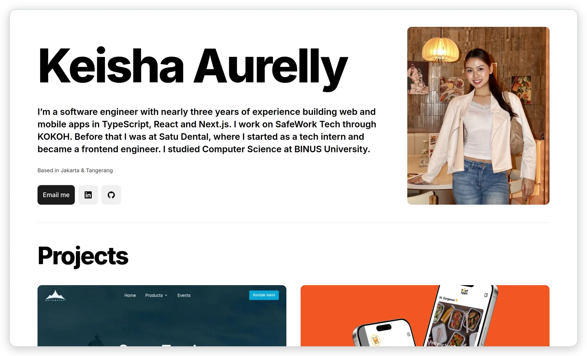

<picture>
  <source media="(prefers-color-scheme: dark)" srcset=".github/screenshot-dark.webp" />
  
</picture>

## Built with

- [Next.js](https://nextjs.org) (App Router), React and TypeScript
- [Astryx](https://github.com/meta/astryx) components with a custom `portfolio` theme
- [simple-icons](https://simpleicons.org) for the stack logos, Inter for type

## Where things live

```
src/
├── app/           the page, layout, global styles and icons
├── components/    project cards, experience rows, photo gallery
├── data/          projects.ts and jobs.ts, the site's content
└── themes/        generated theme output
themes/portfolio/  theme source
public/            photos and project covers
```

To add a project or a job, add an entry to `src/data/projects.ts` or `src/data/jobs.ts` and put its images in `public/`. The theme is changed with `npx astryx experimental theme editor`, not by editing the generated files.
